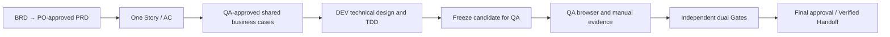

# Getting started as PO, DEV, or QA

Optional `team.role-delivery`: PO approves requirements → QA approves cases → DEV implements → QA executes → independent dual Gates → final approval. Complete your role and hand off. One human holding several roles must approve each explicitly without claiming independent human review. New/solo projects start with [Getting started](getting-started.md).

Code blocks are **prompts for AI, not terminal commands**; replace placeholders. The host supplies files, independent children, connections, and browser capabilities. Skills create no service or external permissions.

## Prepare workspaces and connections

| Your role | Where to open AI | Prepare before starting |
|---|---|---|
| PO | A local project collaboration directory in an AIDLC-capable tool; Git is optional | BRD/existing PRD/Jira requirements, business scope, Jira project, PO owner, optional PRD publishing location |
| DEV | The actual business code repository root | Story + AC, PO-approved snapshot, QA-approved cases, GitLab project, technical owner, existing work/handoff references |
| QA | A local collaboration directory or business repository; source checkout is optional | Before development: Story/AC and PO approval. For execution: test package, candidate/artifact, environment, accounts, and operation scope |

Complete [installation/version verification](getting-started.md#install); select a [local source](getting-started.md#local-source) for unpublished capabilities. Do not assume `main` has them. For existing installations, fill configuration gaps while preserving work/team packs/approvals.

For a new PO/QA non-code workspace without an existing handoff:

```text
Read https://raw.githubusercontent.com/xuhongjia/aidlc-agents/main/bootstrap/setup.md.
Install AIDLC in <workspace> as my specified <PO/QA> non-code collaboration workspace;
do not initialize Git. Use it only for role analysis or received frozen QA execution
packages; code implementation remains in the business repository. Enable checks and
automatic updates before new requests, keeping existing requests on their original
version. Stop after the capability test.
```

For an existing handoff, verify/restore its original method/assets. For local installation, identify the role directory in the local-source prompt.

After installation, send in each workspace:

```text
setup role delivery: I am <PO/DEV/QA>; this workspace is <path>.
Jira project: <link/ID>. GitLab project: <link/ID>. PRD location: <location or unconfigured>.
PO / QA / technical / final owners: <real accounts or pending confirmation>.
Inspect existing configuration, actual connections, and role permissions. Preserve
existing work/customization; list gaps and configuration differences.
Complete setup checks only; do not create business work or publish content.
```

[aidlc-role-setup](../skills/setup/aidlc-role-setup/SKILL.md) requires real project/field/account IDs; it neither creates Jira types/fields nor makes the assignee every approver. PO/QA workspaces hold method/configuration/records/snapshots; full coordination and code changes stay in the business repository. Every formal stage needs a fresh independent child and local frozen files; missing either is `blocked`.

QA needs actual browser bindings and targets. Setup displays the [role template](../examples/team-packs/role-team/pack.json) operation scope; a connection name or “testing allowed” is insufficient. Missing bindings/capability stay `pending/NOT_RUN`. Broaden operations only through namespaced stages/workflows and confirmed [role-protocol](../workflow/role-delivery.md) changes, preserving old work.

## Handoff order for one Story



Deliver verifiable Story/slices, not necessarily the entire PRD. Reuse existing Story/work references across sessions. Preparation has analysis records; handoffs retain their method/approved baseline. After delivery starts, only the original parent writes central state.

<a id="po"></a>

## PO: turn business material into an acceptable Story

**1. BRD → PRD.** Provide local originals or readable frozen sources to [aidlc-prd](../skills/role-collaboration/aidlc-prd/SKILL.md):

```text
Use aidlc-prd on <BRD path/link> for <goal/scope>. Check <work/handoff or none>
for duplicates. Preserve sources and FR/NFR mappings; separate facts, proposals,
and open decisions. Return a draft for review.
```

Review goals/scope/rules/unknowns, then the configured PO states: “As PO, approve `<PRD review reference and version/digest>` for `<scope>`.” This approves preparation, not every Story or development. Skip to step 2 for an already approved PRD.

**2. Start with one Story.** Use [aidlc-story](../skills/role-collaboration/aidlc-story/SKILL.md):

[Story templates](jira-story-templates.md) provide overview, source mapping, and Given/When/Then AC in English (default) or Simplified Chinese. Select per new work/project; each child loads one template.

```text
Use aidlc-story for <behavior> from <approved source and approval>. Include
scope/non-goals, stable AC/source mapping, dependencies, slices, and blockers.
Existing Jira Story: <project/Issue ID or none>; work/handoff: <reference>.
Propose differences for existing objects; return the draft for review.
```

PO reviews every AC and included/excluded requirement, approving the exact Story/AC version. Ambiguity, unverifiable AC, or missing provenance blocks the development baseline.

**3. Publish if authorized, then hand off to QA.** Role approval is separate from publication. Inspect the target/frozen diff, then authorize create/update:

```text
I approve <Story/AC review reference and version/digest>.
Authorize publishing the displayed <frozen content reference> to Jira project <project ID>:
<create the Story for draft ID, or update specified fields of existing Issue ID>,
plus <explicit link/attachment operations>. Limit actions to this target and content.
Reread to verify, then return the actual Issue ID, publishing receipt, and handoff reference.
```

Without publishing authority, hand off local drafts/snapshots. PRDs use configured Confluence or Jira-linked documents; Confluence also needs target/content authorization. Do not reconfirm actions already validly authorized.

**Hand off:** stable Story ID, frozen Story/AC, PO approval/sources, and `requirements_ready`. `analysis_complete` / `requirements_ready` completes preparation, not delivery. PO-only users wait for QA/DEV.

<a id="qa"></a>

## QA: approve cases first, then execute the candidate

**Before development, confirm shared business cases.** In the QA workspace, use [aidlc-test-design](../skills/role-collaboration/aidlc-test-design/SKILL.md):

```text
Use aidlc-test-design for Story <ID>, handoff/PO approval <reference>. Cover each
AC, boundaries, and risks with stable Case IDs, preconditions, data setup/cleanup,
steps, precise expectations, execution method, and gaps. Reuse <Task/work or none>;
show differences for review without executing tests or changing product/test code.
```

Derive expectations from requirements; PO owns rule/AC changes. QA adds boundaries/risks, then the actual owner states: “As QA, approve `<test-design review reference and version/digest>` as DEV’s baseline for this Story.” Use the publishing template for Jira authority. Default to synthetic data; retain safe fixtures/generators in-repo. Never upload credentials or production personal data.

**Hand off:** `test_design_ready`, approved case version, and provenance. One design Task per Story contains stable Case IDs; unit tests/parameter combinations need no separate tickets.

**After development:** receive the same work’s `implementation_ready_for_qa` package, not just its Story link. Use [aidlc-qa](../skills/role-collaboration/aidlc-qa/SKILL.md):

```text
Use aidlc-qa to continue the QA node of work <work ID>; test handoff/execution package: <reference>.
Verify the original method, approved cases, complete frozen candidate, and actual artifact
identity at <test environment URL>. List required accounts, data, browser operations,
cleanup scope, and Cases needing human observation. Keep the original delivery graph;
report missing inputs, authorization, or build identity without creating new delivery work.
```

After reviewing actual operation scope, authorize it within your permissions, for example:

```text
Authorize <approved case version> for work <ID> / dispatch <reference>:
only in <test environment URL/instance>, using <test-account identifier>, for
<Case IDs and specific operations>. Allow creating/modifying <bounded test data>;
cleanup covers only data created in this run. Valid until <expiry>.
Use the displayed tool bindings; retain actual observations, failures, and NOT_RUN.
Assign manual checks to <executor>.
```

Keep passwords out of prompts/configuration. Before each side effect, read the current shared controller and verify authority; old snapshots cannot prove validity. Use an authorized host sharing coordinator state or remain `blocked`. Unknown environment/candidate identity or incomplete required manual observations cannot pass.

**Return:** actual Case/step results, case/candidate/artifact/environment/data versions, executor/time, screenshots/logs, failures, and untested items. Manual checks need real observations; AI cannot sign for humans. QA-owner confirmation binds exact results; return the package to the original parent without editing state/code. `qa_execution_complete` means complete records; required `FAIL/NOT_RUN` still blocks acceptance.

To publish results to Jira, tell the original coordinator: “Sync test results: publish the frozen summary of `<confirmed execution-record version>` to `<Story and result-Task creation intent/existing ID>`, allowing `<explicit operations>`. Retain failures/history and reread to verify.” Keep one result record per execution round; do not overwrite earlier PASS/FAIL.

<a id="dev"></a>

## DEV: design, TDD, hand off for QA, and collect verification

**1. Use the business repository.** Obtain PO/QA-approved baselines; return missing approvals to their owners.

```text
Use configured team.role-delivery for Story <Issue ID>.
PO Story/AC approval and requirements_ready: <reference>.
QA case approval and test_design_ready: <reference>.
Existing delivery work: <ID or not started>; continue it if present rather than duplicating it.
Verify the original method/baseline, then propose technical Spec, task slices,
dependencies, AC/case mappings, and dual-Gate rules. Keep technical content in the
business repository with Story references; submit to the technical owner first.
```

The Spec covers architecture/API/data constraints, rationale, Oracle, and implementation scope. Jira Story/AC remains the requirement source. QA confirms new expectations; PO confirms changed AC.

**2. Continue after technical approval and implementation authorization.** The configured technical owner confirms, for example:

```text
As technical owner, approve <technical design/plan review reference and version> for work <ID>.
Authorize Implement for <slices/tasks and code scope> only, using approved AC/Oracle
for TDD and affected regression. Then freeze the candidate, produce Case-to-script/check
mappings and real self-test evidence, and submit the QA handoff for my confirmation.
```

Implement alone runs RED → GREEN → REFACTOR. Cases may map to many unit/integration/UI checks; mappings are not PASS evidence. After technical-owner candidate confirmation, hand off `implementation_ready_for_qa`: frozen candidate, reports, environment/artifact identity, cases, and QA package. This is neither formal Gate PASS nor delivery completion.

**3. Receive QA evidence, then complete verification.** Continue in the original business-repository coordination session:

```text
continue work <ID>: receive QA package <reference> and QA-owner confirmation <reference>.
Verify candidate, case version, authorization, and all required evidence; report affected
scope if anything changed. Once eligible, have the parent dispatch independent Architecture
and Quality Gate Reviewers, then an independent collector. Submit the final review to the
final owner without automatically marking Done, merging, or publishing.
```

Formal dual Gates normally run once after required QA evidence. Reviewer/contributor/collector Agent and run identities must satisfy independence; DEV self-review or renamed roles cannot substitute. Candidate/baseline changes invalidate affected evidence.

**Endpoint:** the final owner reviews candidate/evidence and states: “As final owner, approve `<final review/version>` for work `<ID>`, confirming acceptance evidence and scope for `<candidate digest>`.” All conditions must pass for **Implementation Verified Handoff**. DEV cannot sign for QA/final. Jira Done, merge, production publication/deployment, and business benefit remain separate.

## Continue after case changes

Retain Case IDs/approvals/history. Even wording changes need differences and impact assessment; changed steps/data/expectations/coverage need new approval. Old executions prove only old cases. PO confirms changed business expectations/AC before QA approval.

```text
Sync cases for Story <ID>; original work/handoff: <reference>; new QA-approved version: <reference>.
Compare the old baseline, current approved cases, and repository script-mapping;
list affected scripts/results. Preserve manual content and history. Return code,
fixture, or script changes to controlled Implement with applicable authorization.
After affected tests and required regression, freeze a new candidate and schedule
necessary QA/verification again.
```

Without repository authority, QA returns a DEV sync request; unapproved drafts allow difference analysis only. Never weaken assertions in QA/Verify. Explicit sync/DEV continuation creates no watcher or automatic push/MR/merge/deployment/CI trigger. See [aidlc-test-sync](../skills/sync-publication/aidlc-test-sync/SKILL.md) and [case sync](../workflow/testcase-sync.md).

## New sessions, blockers, and publishing failures

Handoffs need **stable Story ID, work/handoff reference, frozen content/approvals, method version, and GitLab evidence links**. Generate a resumable package. Verify snapshots/digests; current link content cannot replace an approved version. File handoff needs no Jira publishing authority. Retain reports under project policy; expired links are invalid evidence.

| Situation | Next step |
|---|---|
| New AI session or computer | Provide `continue work <ID>` and the handoff; restore original method/graph/approvals without upgrading existing work to the current installation |
| Missing role, connection, permission, candidate identity, or report | Keep `pending/blocked/NOT_RUN` and supply the missing input; setup success does not prove integration or tests ran |
| Concurrent human edits in Jira/documents/code | Review differences and preserve human content; do not overwrite by similar titles or apply old approval to a newer version |
| External write times out or outcome is unclear | Record `unknown` and verify read-only before retrying creation. Record receipts per target and do not resend successful actions |
| Delivery is verified but Jira publishing fails | Preserve the delivery conclusion and failed receipt. On explicit retry, check original content/current authority without rerunning delivery |
| Remote QA wants to change central state or take control | Return to the original coordinator. Transfer requires evidence the previous executor stopped and an explicit recorded handover; lease expiry does not prove termination |

The [role protocol](../workflow/role-delivery.md), [worker contract](../workflow/role-worker.md), and [Jira adapter](../adapters/collaboration/jira.md) define execution boundaries. These instructions do not establish completed company Jira/GitLab/browser testing.
