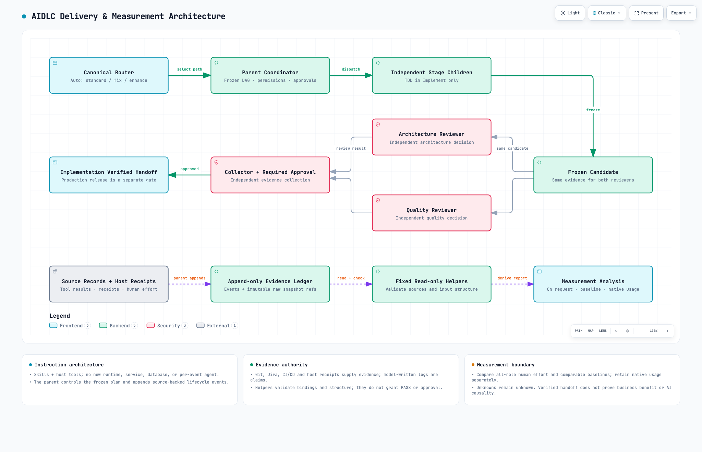
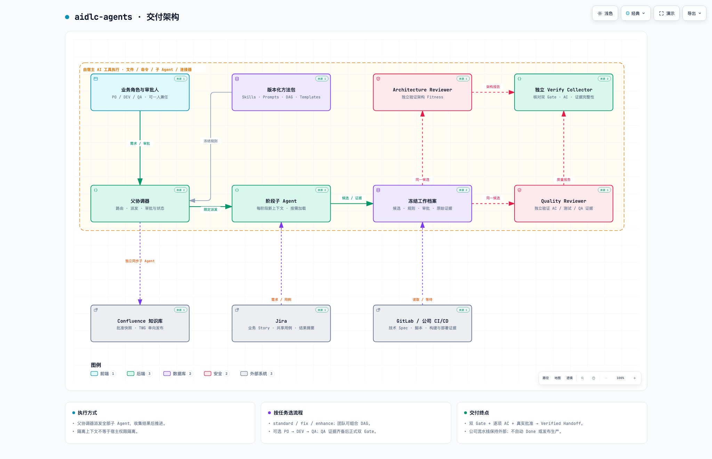
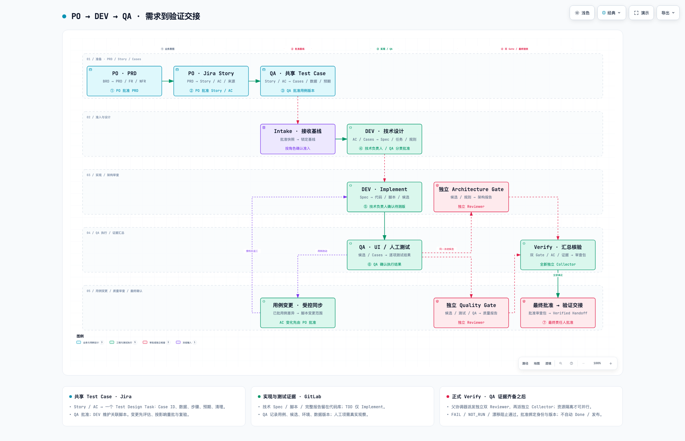

# Visual guides

The current English architecture describes the local 0.17 delivery and measurement method in this working tree, based on revision `9607217288f8319ff11a61220c03e4d50de91efe`. Its receipt pins the exact source assets used, including changes after that base revision. It is an instruction and host-tool architecture, not a deployed service topology. Diagrams are outside the installed method payload.

| Guide | Status | Interactive HTML | Source and validation |
|---|---|---|---|
| Delivery and measurement architecture | Current English working-tree view | [Open or download](en/architecture/index.html) | [Definition](en/architecture/spec.json) · [Receipt and source hashes](en/architecture/validation.json) |
| Delivery architecture | Historical Simplified Chinese | [Open or download](zh-CN/architecture/index.html) | [Definition](zh-CN/architecture/spec.json) · [Original receipt](zh-CN/architecture/validation.json) |
| PO / DEV / QA workflow | Historical Simplified Chinese | [Open or download](zh-CN/po-dev-qa/index.html) | [Definition](zh-CN/po-dev-qa/spec.json) · [Original receipt](zh-CN/po-dev-qa/validation.json) |

GitHub displays HTML source. Download the file or clone the repository, then open `index.html` in a browser. Each HTML is self-contained; no server or setup is required.

## Current delivery and measurement architecture

The canonical router selects a suitable standard, fix or enhance path. The parent controls the frozen DAG, permissions, approvals and independent child dispatch. TDD stays in Implement. Separate Architecture and Quality Reviewers examine the same frozen candidate; an independent collector and required approval precede Implementation Verified Handoff. Production release remains separate.

The lower evidence path reuses Git, Jira, CI/CD, host receipts and human effort records. The existing parent appends source-backed events and immutable raw-snapshot references at existing lifecycle transitions. Fixed read-only helpers validate and calculate from retained records; they do not write the ledger, authenticate a source or grant PASS. On-request analysis keeps comparable human effort, baselines and native usage distinct, preserves unknowns, and does not turn a verified handoff into business benefit or AI causal proof. The diagram adds no runtime, service, database or per-event Agent; component colors are viewer categories.

This view passed all 9 showcase checks with 0 errors and 0 warnings using unmodified Archify 2.16. Desktop containment passed at 1440×900, 1600×1000, 1920×1080 and 2048×1320. The light/dark contact sheet and captures at the smallest and largest sizes were inspected. The compact receipt binds the exact specification, HTML, preview, source assets and inspection evidence. Only the large light-theme preview is retained; interactive export behavior was not tested.

## Historical Simplified Chinese guides

These two reference diagrams remain unchanged at source revision `1015e2b9a0369d70b5c0c52116721626b120624e`. They are historical illustrations rather than the current English measurement contract, and are separate from the immutable Chinese method archive. Their receipts record the original 9/9 showcase validation and light/dark inspection; those historical checks were not rerun for this update.

The delivery architecture shows the coordinator, independent stage agents, pinned evidence, two Gate Reviewers and Collector, plus optional Jira, GitLab and Confluence connections.

The PO / DEV / QA workflow shows approved shared cases, technical design, Implement-scoped TDD, QA execution, formal dual Gates and final approval. Preparation precedes the five-node role delivery DAG; Reviewer/Collector runs belong to Verify. Verified Handoff does not automatically mark Done or publish to production.

## Reproduction and updates

The current English architecture and historical Chinese architecture use the unmodified Archify 2.16 renderer. The historical Chinese workflow uses a [layout patch](zh-CN/po-dev-qa/renderer-layout.patch) in a private renderer copy to enlarge the fixed grid/fonts and expose approval tags; its validation rules are unchanged. Apply it with `git apply --unidiff-zero <patch-path>` from that private copy when reproducing the historical workflow. Archify is not an installation dependency of aidlc-agents.

For a current diagram update, check the method sources, validate and deliver the specification with `--quality showcase`, run `visual-check`, inspect its actual light/dark rendering and contact sheet, then refresh HTML, preview and receipt together. Preserve the distinction between a base commit and uncommitted working-tree assets. Keep local paths, credentials, temporary candidates and superseded captures out of this directory.
